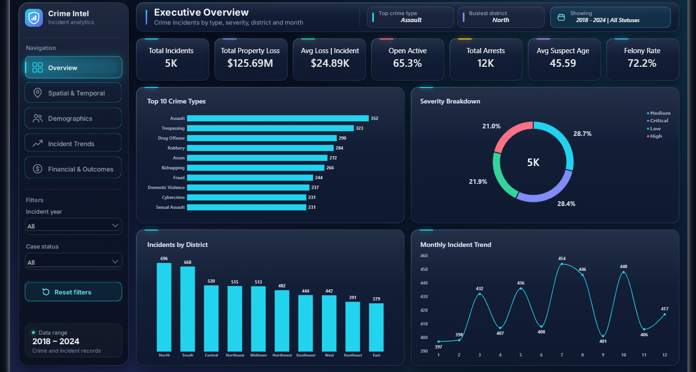
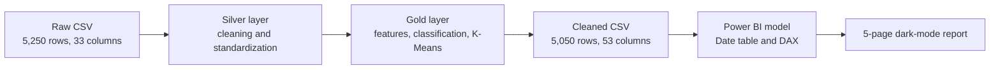

<div align="center">

# 🛡️ Crime Intel: Law Enforcement Analytics & BI Command Center


**A cleaned crime incident dataset and a five-page dark-mode Power BI command center for exploring where, when and how incidents were recorded.**



| 5,050 | 10 | 2018 to 2024 | 5 | 11 |
|:---:|:---:|:---:|:---:|:---:|
| cleaned incidents | districts | period covered | report pages | imputation audit flags |

[Overview](#-project-overview) · [KPIs](#-executive-kpi-highlights) · [Workflow](#-project-architecture--workflow) · [Tech stack](#-tech-stack) · [Insights](#-key-insights) · [Recommendations](#-strategic-recommendations) · [Showcase](#-dashboard-showcase-pages-2-to-5) · [Structure](#-project-structure) · [Run it](#-run-it-yourself) · [Data notes](#-data-notes--limitations) · [Author](#-author)

</div>

---

## 📌 Project Overview

Crime Intel turns a raw crime incident file of 5,250 rows into 5,050 cleaned incidents across 10 districts, from 2018 to 2024. A Python pipeline removes duplicates, resolves messy crime type and district labels with fuzzy matching, fills missing values with group-based rules, and adds a rule-based Felony or Misdemeanor label and an exploratory K-Means segmentation.

A five-page Power BI report reads the cleaned data and works as a dark-mode command center for a patrol-planning team. Every page repeats seven core KPIs and carries year and case status slicers and dynamic DAX header cards. The data looks synthetic (see [Data Notes & Limitations](#-data-notes--limitations)), so the findings demonstrate the workflow and do not describe a real city.

- **Python pipeline:** deduplication, `thefuzz` fuzzy matching (Levenshtein distance), conditional group-based imputation with 11 `*_imputed` audit flags, an offense classification heuristic (Felony vs Misdemeanor) and exploratory K-Means clustering (k = 4).
- **Power BI report:** five dark-mode pages, seven core KPIs per page, dynamic DAX headers, and year and case status slicers.
- **Audit trail:** every filled value is flagged, so charts labeled "recorded values" can exclude them and totals can be shown with and without estimates.

---

## ⚡ Executive KPI Highlights

| Metric | Value | Context |
|---|---|---|
| **Total incidents** | **5,050** | 200 duplicate IDs removed from 5,250 raw rows |
| **Total property loss** | **$125.69M** | $112.10M recorded plus $13.58M imputed |
| **Average loss per incident** | **$24.89K** | $24.91K on recorded losses only |
| **Open or active cases** | **65.3%** | Open, pending or under investigation |
| **Total arrests** | **11,731** | Imputed arrest counts default to 0, so the total comes from recorded values |
| **Average suspect age** | **45.59** | 45.43 on recorded ages only |
| **Felony rate** | **72.2%** | Rule-based classification, not a legal determination |

---

## 🔄 Project Architecture & Workflow



### 1. Silver layer: cleaning and standardization

- **Deduplication:** 200 duplicate incident IDs removed, which takes the file from 5,250 to 5,050 rows.
- **Fuzzy matching:** `thefuzz` (Levenshtein distance) consolidated 182 raw crime type spellings into 36 labels and 131 district spellings into 10 canonical districts. Five alias labels were missed (see the data notes).
- **Conditional imputation:** the most common value within crime type and district (falling back to crime type) for gender, weapon and case status, the district mode for severity, and medians for ages and property loss. Eleven `*_imputed` flags record every filled value.
- **Validation:** coordinates are bounded to latitude 24 to 49 and longitude -125 to -67, and negative losses and arrest counts are converted to absolute values.

### 2. Gold layer: feature engineering and ML

- **Offense classification heuristic:** Felony or Misdemeanor from crime type rules, a severity rule for assault-type offenses and a $2,500 loss threshold for theft and fraud types. 37.6% of rows carry a review flag because the class depended on a threshold or an unlisted crime type.
- **K-Means clustering:** k = 4 on scaled latitude, longitude, hour and property loss. The silhouette score is 0.195, so the segments are exploratory.

### 3. BI engineering: Power BI

- **Model:** an incident fact table with a marked Date table (a minimal star schema), `SAMEPERIODLASTYEAR` for year-over-year change, and a disconnected gender table with `TREATAS` to compare suspects and victims on one axis.
- **Header cards:** three dynamic DAX cards on every page, a filter summary plus two page-specific facts.
- **Interaction:** year and case status slicers, a Reset filters button and a navigation panel shared by all five pages.

---

## 🧰 Tech Stack

| Area | Tools | Used for |
|---|---|---|
| Language | Python 3.12 | The cleaning and analysis pipeline |
| Data processing | Pandas, NumPy | Cleaning, aggregation, derived fields |
| Entity resolution | TheFuzz | Fuzzy matching of crime types and districts |
| Machine learning | Scikit-Learn | StandardScaler, KMeans, silhouette score |
| Exploration | Matplotlib, Seaborn, Jupyter Notebook | Exploratory charts and the run-through notebook |
| Statistics | SciPy | Chi-square checks quoted in the insights |
| Business intelligence | Power BI Desktop, Power Query, DAX | Data model, measures and the five-page report |
| Version control | Git, GitHub | Repository and history |

---

## 📊 Key Insights

- **Peak window:** 02:00 is the busiest hour with 252 incidents, 24% above the 203 hourly average, and 09:00 follows with 249. Thursday has the highest weekday volume (735 incidents with a timestamp). No single weekday and hour cell dominates, since the highest has 45 incidents.
- **Geographic concentration:** North leads with 696 incidents, and the three busiest districts (North, South and Central) hold 37% of all incidents.
- **Top crimes:** Assault (352), Trespassing (323) and Drug Offense (290), using the labels as exported.
- **Yearly stability:** volume stayed between 683 and 768 incidents. The largest rise was +8.5% in 2024 and the largest drop was -5.6% in 2023, and the changes are not statistically significant (chi-square p = 0.27).
- **Weapons:** firearms represent 37% of recorded weapons (1,539 of 4,120).
- **Financial loss:** average recorded loss is $24.5K to $26.4K across the eight most frequent crime types, so crime type does not separate loss in this data.
- **Victim ages:** spread evenly, 501 to 551 per age group. The 80+ group is the largest only because it covers 11 ages (80 to 90) while the others cover 10.

---

## 💡 Strategic Recommendations

- **Patrol shift alignment:** cover 02:00 and 09:00, which run 24% and 23% above the hourly average. Weekday differences are small, so plan by hour rather than by day.
- **District clearance tracking:** North and South together record 27% of incidents (1,364 of 5,050). The report has no clearance rate by district, so adding that measure is the natural next step.
- **Open backlog audit:** 65.3% of cases are open, pending or under investigation (66.2% on recorded status). Track the share by year and crime type to see where cases stall.
- **Validate before acting:** the dataset looks synthetic and most differences are small, so repeat the analysis on verified data before any staffing decision.

---

## 🚀 Dashboard Showcase (Pages 2 to 5)

### 2. Hotspots & Timing


A weekday by hour heatmap, incidents by weekday and by hour, and incidents by state. The weekday and hour charts count the 4,877 incidents that have a recorded time of day.

### 3. Suspect & Victim Profiles


Age distributions for suspects and victims (recorded ages), a gender comparison and the race breakdown of identified suspects. The two peak-age header cards show the median fill values, 46 and 50 (see the data notes).

### 4. Trends & Seasonality


Year-over-year change, incidents per year, a month by year heatmap and the five most frequent crime types over time. The largest yearly rise is +8.5% (2024) and the largest drop is -5.6% (2023).

### 5. Financial Impact & Case Outcomes


Average recorded loss by crime type, weapon use, case resolution and case status, all on recorded values. Firearms lead at 37% of recorded weapons. The "Most used weapon" header card differs from the grouped chart (see the data notes).

---

## 📁 Project Structure

```text
Crime-Intel/
├── README.md
├── requirements.txt
├── .gitignore
├── notebooks/
│   └── Crime_Data_after_cleaning.ipynb
└── dashboard/
    ├── Crime_Intel.pbix
    └── images/
        ├── 1_Executive_Overview.png
        ├── 2_Hotspots_Timing.png
        ├── 3_Suspect_Victim_Profiles.png
        ├── 4_Trends_Seasonality.png
        └── 5_Financial_Outcomes.png
```

| Path | Purpose |
|---|---|
| `notebooks/Crime_Data_after_cleaning.ipynb` | Profiling, cleaning, feature engineering, clustering, classification and export of the cleaned CSV |
| `dashboard/Crime_Intel.pbix` | Power BI report that reads the cleaned CSV |
| `dashboard/images/` | Exports of the five report pages used in this README |
| `requirements.txt` | Python packages for the notebook |
| `.gitignore` | Keeps the raw and cleaned CSV files out of Git |

---

## 🧪 Run It Yourself

Clone the repository and set up the environment:

```bash
git clone https://github.com/mazen3499/Crime-Intel.git
cd Crime-Intel
python -m venv .venv
source .venv/bin/activate          # Windows: .venv\Scripts\activate
pip install -r requirements.txt
```

Save the raw file as `notebooks/crime_incidents_messy.csv`. It is not in the repository (see the data notes). Then start Jupyter Lab from the notebook folder:

```bash
cd notebooks
jupyter lab
```

Open `Crime_Data_after_cleaning.ipynb` and run all cells from top to bottom. The notebook writes `crime_incidents_cleaned.csv` (5,050 rows, 53 columns) next to itself.

Open the report in Power BI Desktop on Windows:

1. Open `dashboard/Crime_Intel.pbix`.
2. To refresh from your own copy, change the file path under Transform data, then Data source settings.
3. If the CSV source step contains `Columns=`, set it to 53 or remove it.

The notebook was run end to end on Python 3.12. `requirements.txt` has not been tested in a clean environment.

---

## 🔎 Data Notes & Limitations

- **Privacy and PII:** the raw file contains officer, suspect and victim names, victim phone numbers and street addresses. Data files are excluded from the repository by `.gitignore` (`*.csv`). The `.pbix` embeds its data, so remove those columns in Power Query before publishing it.
- **Synthetic distribution:** coordinates are spread almost evenly and do not follow the recorded state, and category counts are close to uniform. The source and license of the dataset are not documented, so the results illustrate the workflow rather than describe a real city.
- **Imputation flags:** eleven fields needed filling, and each fill is recorded in a boolean `*_imputed` column. Charts labeled "recorded values" exclude those rows, while totals such as property loss include the estimates.
- **Unmerged aliases:** fuzzy matching missed five labels, `D.U.I.`, `Dwi` and `Drunk Driving` (DUI), `Dv` (Domestic Violence) and `B&E` (Breaking & Entering). Merged, DUI would reach 353 incidents, ahead of Assault at 352, and Domestic Violence would reach 320. Rankings here use the labels as exported.
- **Zero timestamps:** 173 incidents are stamped exactly 00:00:00, so the hourly and weekday visuals exclude them and show 4,877 of 5,050. A further 329 missing timestamps were copied from the previous row.
- **Header cards:** "Peak suspect age" (46) and "Peak victim age" (50) equal the median fill values, and "Most used weapon" (Blunt Object) differs from the Weapon Used chart, where Firearm is highest.
- **Assumptions and models:** negative losses and arrest counts are treated as sign errors and made positive. The K-Means silhouette is 0.195 at k = 4, the Felony or Misdemeanor rules were not checked against legal sources, and the chi-square and silhouette checks were run outside the notebook.
- **Counts, not rates:** the data has no population figures.

| Field | Rows filled in | Share of 5,050 |
|---|---|---|
| `suspect_gender` | 1,657 | 32.8% |
| `suspect_age` | 1,375 | 27.2% |
| `victim_gender` | 1,330 | 26.3% |
| `victim_age` | 931 | 18.4% |
| `weapon_used` | 930 | 18.4% |
| `resolution` | 912 | 18.1% |
| `case_status` | 696 | 13.8% |
| `property_loss_usd` | 550 | 10.9% |
| `severity` | 342 | 6.8% |
| `incident_datetime` | 329 | 6.5% |
| `num_arrests` | 324 | 6.4% |

---

## 👤 Author

**Mazen Walid**

Data Analyst | Turning Data Into Decisions — Python, SQL, Excel, Power BI, Tableau & Problem-Solving

[](https://www.linkedin.com/in/mazen-walid)
[](https://github.com/mazen3499)
